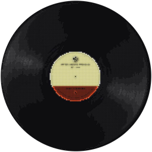
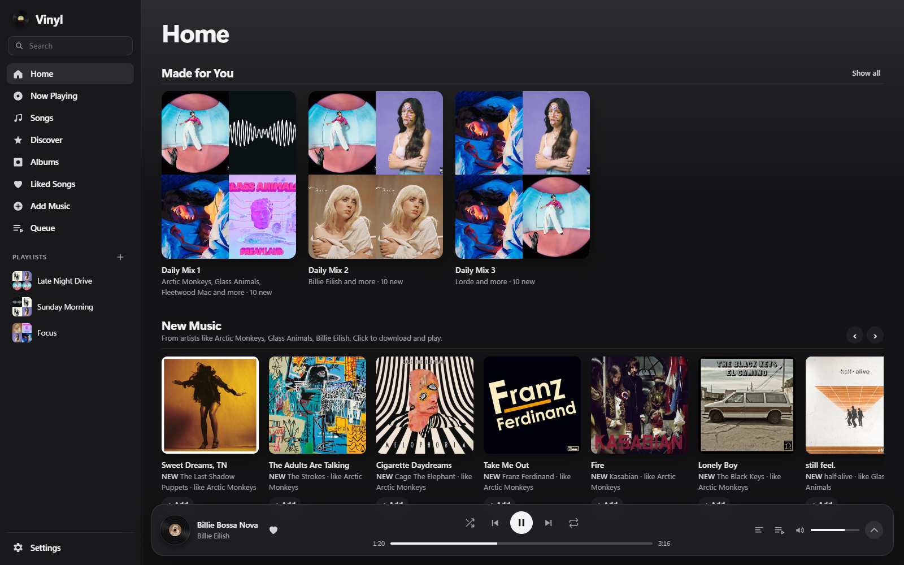
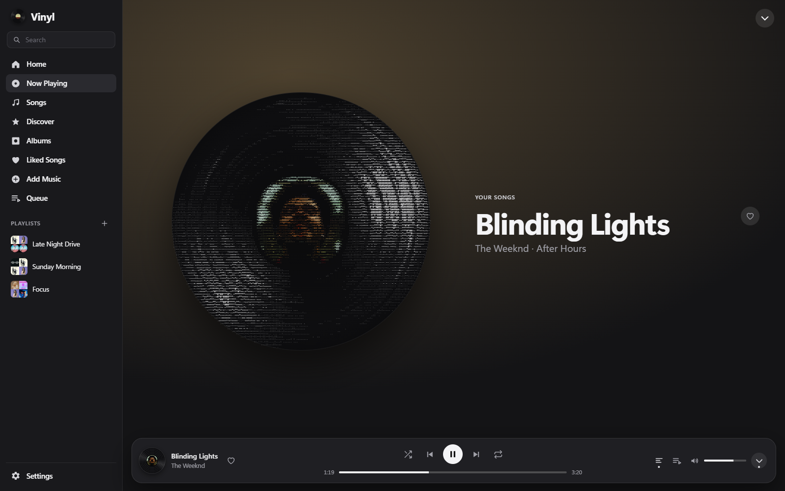
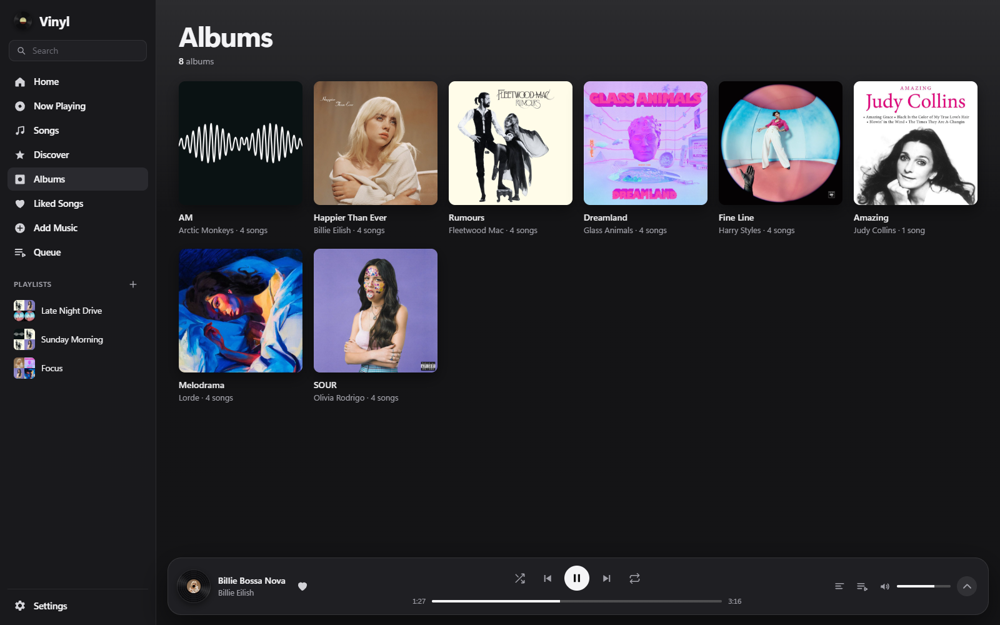
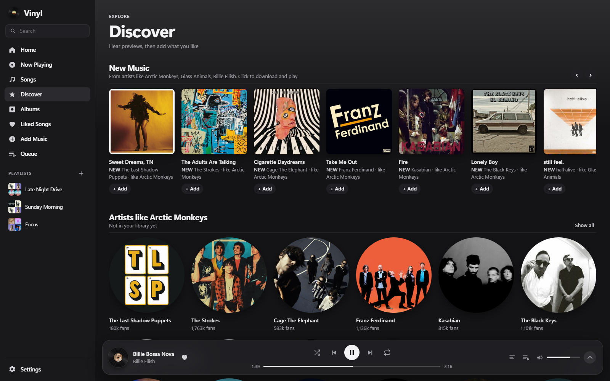
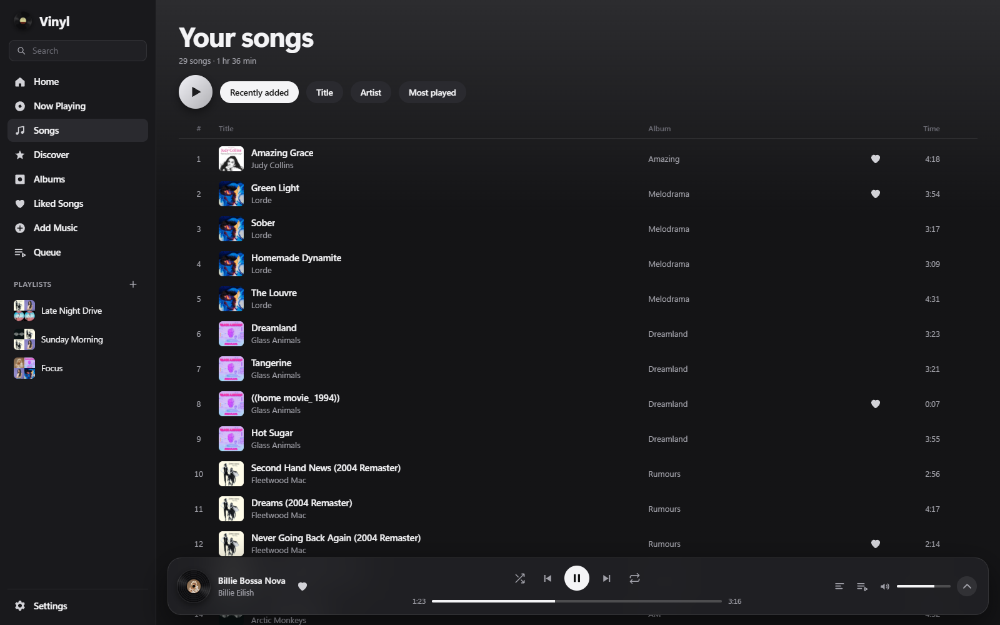
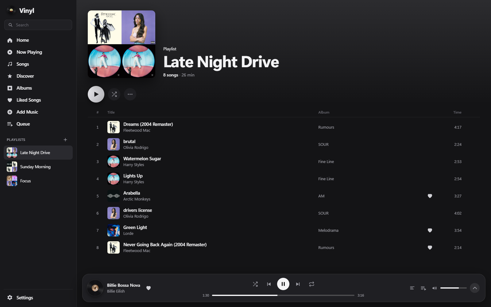

<p align="center">
  
</p>

<h1 align="center">Vinyl</h1>

<p align="center"><b>A local music player that keeps the record spinning.</b></p>

<p align="center">
Your own songs on Windows, with Daily Mixes, new music from similar artists, and a spinning ASCII vinyl on the Now Playing page. Add music from YouTube and Spotify links, and Vinyl keeps itself up to date.
</p>

<div align="center">


[](https://github.com/HunterGHall/vinyl/actions/workflows/release.yml)
[](Cargo.toml)
[](https://developer.microsoft.com/microsoft-edge/webview2/)

</div>

<p align="center">
  <a href="#screenshots">Screenshots</a> ·
  <a href="#install">Install</a> ·
  <a href="#features">Features</a> ·
  <a href="#running-from-source">Running from source</a> ·
  <a href="https://github.com/HunterGHall/vinyl/releases">Releases</a>
</p>

## Screenshots

<p align="center">
  
  
</p>
<p align="center">
  
  
</p>
<p align="center">
  
  
</p>

<sub>Screenshots use a demo library: other artists' albums with silent placeholder audio.</sub>

## Install

Download **`vinyl-setup.exe`** from the [latest release](https://github.com/HunterGHall/vinyl/releases/latest) and run it.

## Features

**Your library**
- Add songs from YouTube or Spotify links, or search the catalog and press Add.
- Importing a playlist asks whether to keep it as a playlist or just add its songs, and the progress bar moves with every song.
- Playlists, Liked Songs, a queue, and album names for your songs (looked up in the background), with an Albums page.
- Time-synced lyrics, volume levelling, and keyboard **media keys** (play/pause, next, previous, stop) that work even when Vinyl is in the background.

**Recommendations**
- **Made for You** Daily Mixes, built from your own plays, likes, history and playlists. Nothing leaves your computer.
- **New Music** and **Discover**: songs from artists related to the ones you listen to, plus genre charts, using Deezer's public API. Click a song to download and play it.
- Starting from an empty library? Pick a few genres and Vinyl builds a starter crate for you.

**Now Playing**
- The record is rendered as live ASCII and spins while music plays, on a platter tinted from the cover, next to big synced lyrics.

**Keeping it running**
- Settings shows whether yt-dlp and ffmpeg are installed and can install them, and can reset your recommendations or delete your data.

Shortcuts: `Space` play/pause, `Ctrl+←/→` previous/next, `←/→` seek 5 s, `L` like, `S` shuffle, `/` search, `Esc` closes Now Playing.

## Running from source

You need [Rust](https://rustup.rs), plus `yt-dlp` and `ffmpeg` on your PATH (or install them from Vinyl's Settings).

```powershell
cargo run --release           # desktop window
cargo run --release -- --web  # just serve http://127.0.0.1:8735 (VINYL_PORT changes the port)
```

Where your data goes: if the current folder already has `library\` or `data\`, Vinyl uses it, otherwise `%LOCALAPPDATA%\Vinyl`. Set `MUSIC_HOME` to pick a folder.

| Variable | What it does |
| --- | --- |
| `MUSIC_HOME` | Folder that holds `library\` and `data\` |
| `MUSIC_DEV_STATIC=1` | Serve `static\` from disk, so front-end edits show on reload |
| `VINYL_PORT` | Port for `--web` mode (default 8735) |
| `VINYL_MEDIA_KEYS=1` | Also enable the media keys in `--web` mode |
| `VINYL_RELEASES_URL` | Point the updater at another releases endpoint (for testing) |


